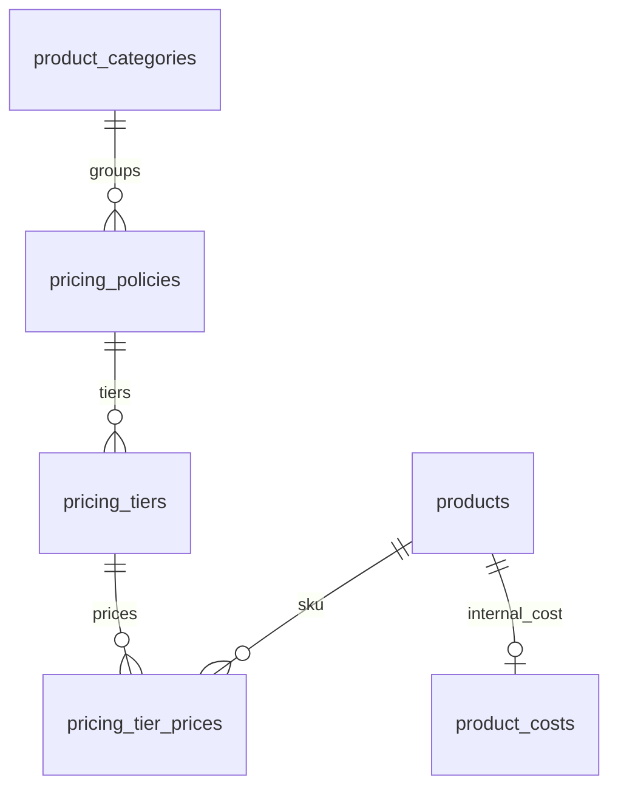

# AMORA Mini 3.3 — chính sách giá và không gian CTV

## Kết quả và phạm vi

Bản này kế thừa bản 3.2, mã mẫu tự động, SKU/size/màu, import/export và catalogue PDF. Thay hai modal nhập giá sỉ/doanh nghiệp lặp lại bằng một màn hình chính sách theo nhóm sản phẩm và bậc số lượng. Không sửa giá thật hoặc đoán lại size của các SKU trong database đang dùng.

CTV có Bảng giá riêng, popup “Chính sách & cách tính”, form báo giá tự tính và dashboard thành tích cá nhân. Quản lý có bảng nhập nhiều bậc cùng lúc, giá vốn nội bộ và kiểm tra lợi nhuận sau hoa hồng. Không thêm CRM, Redis, worker hoặc dịch vụ ngoài.

## 1. Luồng sử dụng cho quản lý

1. Vào Bảng giá → Sỉ & doanh nghiệp · Theo số lượng.
2. Chọn nhóm sản phẩm và kênh Bán sỉ hoặc Doanh nghiệp.
3. Nhập tên chính sách, các ngưỡng bắt đầu và hoa hồng từng bậc. Gợi ý ban đầu trên form: sỉ từ 10/từ 30; doanh nghiệp từ 20/từ 50; tỷ lệ 5%/3%. Đây là bản nháp giao diện, chưa có giá và chưa tự kích hoạt.
4. Điền giá SKU ở các cột bậc. Không cần lặp MOQ/hoa hồng trên từng SKU. Có ô tìm để lọc, khi lưu vẫn lưu toàn bộ nhóm. Tối đa 6 bậc và 500 SKU/nhóm.
5. Có thể copy bảng Excel với cấu trúc SKU, giá bậc 1, giá bậc 2... và bấm Dán giá từ Excel. Cột phân cách bằng Tab; thứ tự bậc từ ngưỡng thấp lên cao. Đối chiếu bằng mã SKU, không dựa vào thứ tự dòng. Dòng trùng, SKU ngoài nhóm, số tiền sai hoặc thừa cột đều bị từ chối cả lần dán. Ô trống giữ giá cũ, dấu - xóa giá ở bậc tương ứng. Dán chỉ sửa bản nháp, chưa ghi database.
6. Nhập giá vốn nếu cần kiểm tra lợi nhuận. Đặt ngưỡng lợi nhuận >0 để bắt buộc kiểm tra khi kích hoạt. Ngưỡng 0 tắt chặn lợi nhuận. Thiếu vốn luôn hiện “Chưa đủ dữ liệu”, không coi là lợi nhuận 100%.
7. Tick Kích hoạt và Cho CTV báo giá nếu muốn công bố. Bấm Lưu toàn bộ chính sách. Hai quản lý lưu chồng sẽ nhận thông báo version cũ, không âm thầm ghi đè.

Các giá vốn 115068/161740 và giá Dolce trong tin nhắn không được tự seed. Quản lý xác nhận sản phẩm/quy cách thực tế rồi nhập. Giá Dolce vẫn cần vốn thật để xác minh lợi nhuận.

## 2. Quy tắc tính giá

- Một nhóm danh mục sản phẩm là một nhóm cộng số lượng. Mỗi nhóm có một chính sách cho sỉ và một chính sách cho doanh nghiệp. Mùi, size, màu khác nhau vẫn cộng chung nếu nằm cùng nhóm.
- Không cộng phụ kiện, hộp, sáp mini vào nhóm nến nếu chúng thuộc nhóm khác. Không cộng khác nhóm chỉ vì cùng đơn vị “lọ”. Muốn tách một dòng nến có điều kiện khác thì tạo nhóm danh mục riêng.
- Kênh xuất phát từ nhu cầu khách: mua lẻ, nhập bán lại, quà tặng doanh nghiệp. Không tự chuyển giữa sỉ và doanh nghiệp chỉ vì đủ số lượng. Các bậc tự chọn trong kênh đã chọn.
- Chọn bậc có min_qty cao nhất mà tổng số lượng cùng nhóm đạt được. Ví dụ bậc 10 và 30 tương ứng 10–29 và từ 30. Mỗi nhóm trong một đơn được tính độc lập.
- Đủ số lượng nhưng SKU thiếu giá ở bậc được chọn: chặn, không lấy giá bậc thấp hơn hoặc giá cũ. Dưới ngưỡng đầu: báo còn thiếu bao nhiêu, chưa được lưu báo giá theo chính sách đó.
- CTV chỉ dùng kênh sỉ/doanh nghiệp khi chính sách nhóm đang active và ctv_allowed. Quản lý cũng phải đạt ngưỡng nếu chính sách active. Giá theo chính sách không sửa trực tiếp trong form báo giá.
- Giá lẻ tiếp tục dùng prices cũ theo từng SKU. Khi chính sách sỉ/doanh nghiệp chưa kích hoạt, quản lý còn có thể dùng giá sỉ/doanh nghiệp cũ theo SKU qua API; CTV không được dùng fallback này.
- Khi chính sách active, endpoint giá cũ và import Excel giá cũ bị chặn cho nhóm/kênh đó, hướng người dùng đến màn hình mới. Tránh có hai nơi sửa nhưng chỉ một nơi được tính.

Hoa hồng dự kiến mỗi dòng = làm tròn đồng(thành tiền dòng × tỷ lệ /100), làm tròn nửa đồng lên. Tổng hoa hồng = cộng từng dòng; phí vận chuyển không hưởng hoa hồng. Đơn do quản lý sở hữu không tự phát sinh hoa hồng CTV; chọn người phụ trách CTV khi tạo để khoản hoa hồng thuộc đúng tài khoản.

Lợi nhuận kiểm tra = (đơn giá − giá vốn − đơn giá × tỷ lệ hoa hồng/100) / đơn giá ×100. Đây là biên sau hoa hồng, chưa bao gồm thuế, hộp phát sinh, vận chuyển hoặc chi phí chung. Mức kiểm tra dùng tỷ lệ chưa làm tròn, nhằm chặn giá thấp một cách nhất quán; số hoa hồng trên chứng từ làm tròn theo từng dòng. Nếu ngưỡng >0 và SKU thiếu vốn hoặc không đạt ngưỡng thì không được lưu chính sách active/không được lập chứng từ mới với giá đó.

## 3. CTV nhìn thấy gì?

- Menu Bảng giá: tên mẫu lớn, mùi/size/màu rõ ràng, giá lẻ và hoa hồng dự kiến trên một sản phẩm. SKU là thông tin phụ. Có tìm kiếm và phân trang.
- Nút Chính sách & cách tính ở dashboard, bảng giá, báo giá và thanh trên cùng. Popup giải thích từng bước, cách cộng nhóm, cách tính hoa hồng, điều kiện ghi nhận và các bậc đang được quản lý cho phép. Không hiển thị chính sách chưa công bố hoặc giá vốn.
- Tạo báo giá: chọn khách và nhu cầu, chọn SKU, nhập số lượng. Sau 250ms ngừng nhập hệ thống lấy kết quả từ API. Kết quả cũ bị bỏ khi nhập tiếp; không hiện tổng cũ như giá mới.
- Mỗi dòng có nhóm, tổng số lượng nhóm, bậc áp dụng, đơn giá, thành tiền và hoa hồng. Không đủ điều kiện có thông báo cụ thể. Nút Lưu chỉ bật khi giá hiện tại hợp lệ.
- Server tính lại khi lưu. Form mới gửi token của kết quả đã xem; nếu quản lý đổi giá giữa lúc xem và lưu, server trả 409 để CTV xem lại mức mới, không âm thầm lưu giá khác.
- PDF gửi khách tiếp tục chỉ có sản phẩm, số lượng, giá, tổng và điều kiện. Không xuất giá vốn, tỷ lệ/số tiền hoa hồng hoặc bản chụp chính sách nội bộ.

Popup là phần giải thích quy tắc hoạt động + dữ liệu bậc đang công bố, không bịa ngày chi trả hoặc thưởng. Chưa bổ sung luồng gửi yêu cầu/duyệt giá ngoại lệ riêng. Với giá ngoài chính sách, CTV liên hệ quản lý; giá sỉ/doanh nghiệp chính thức cần điều chỉnh tại chính sách. Không tự cho phép CTV gõ giá thấp hơn.

## 4. Dashboard và cuộn màn hình

- CTV thấy báo giá tạo trong kỳ, đơn hoàn tất trong kỳ, tiền hàng hoàn tất không gồm vận chuyển, và hoa hồng chưa chi hiện tại.
- Các dấu mốc “Đã bắt đầu”, “Khách tin chọn”, “Trọn lời hẹn” được tính từ dữ liệu trong kỳ; không tạo XP, thứ hạng hoặc thành tích giả.
- Ví hoa hồng tách chờ duyệt, đã duyệt chờ chi và đã chi lũy kế. Không gộp số tiền đã chi lũy kế thành thu nhập của kỳ đang lọc.
- Danh sách gần đây dẫn đến đúng báo giá; nút Báo giá mới mở trực tiếp form.
- Menu, thanh trên cùng và khung ứng dụng cố định. Menu dài cuộn trong vùng menu, không kéo trôi phần tài khoản.
- Desktop từ 1200px rộng và 960px cao: dashboard CTV giữ trong khung; danh sách gần đây và vùng chi tiết dài cuộn riêng. Màn hình nhỏ/thấp cho cuộn vùng nội dung để không cắt mất số liệu, nút hoặc nội dung khi zoom. Không khóa cuộn bằng cách che phần thừa.
- Giữ nền kem, điểm nhấn burgundy; thêm thẻ mềm và ký hiệu nhỏ, vẫn ưu tiên số liệu dễ đọc.

## 5. CSDL và tính nhất quán

Migration mới duy nhất: database/migrations/006_quantity_pricing.sql. Không chỉnh migration001–005 đã áp dụng.

| Bảng | Khóa/ràng buộc | Mục đích |
|---|---|---|
| pricing_policies | PK id; UNIQUE(category_id,channel); FK product_categories | Điều kiện chung của một nhóm/kênh; active, quyền CTV, biên lợi nhuận, version |
| pricing_tiers | PK id; FK policy ON DELETE CASCADE; UNIQUE(policy_id,min_qty) | Các bậc và tỷ lệ hoa hồng |
| pricing_tier_prices | PK(tier_id,product_id); FK tier và product; giá >0 | Một giá cho SKU trong một bậc |
| product_costs | PK/FK product_id; số tiền >=0; version | Vốn nội bộ dùng chung giữa các chính sách, không đưa vào products API |
| quotes/orders | Thêm pricing_snapshot JSONB mặc định {} | Lưu nhóm, số lượng nhóm, bậc, version chính sách, đơn giá và tỷ lệ đã áp dụng |

Ràng buộc CHECK cho kênh, số lượng, tiền, tỷ lệ và version; FK giữ liên kết. Trigger chặn giá SKU gắn vào bậc khác nhóm; chặn chuyển mẫu/SKU sang nhóm khác khi còn giá bậc không tương thích. Nhóm/kênh của chính sách và chính sách cha của bậc là bất biến. Cần bỏ giá bậc cũ trước khi chuyển nhóm, không thay FK để lách điều kiện.

Một lần lưu chính sách và vốn nằm trong một transaction. Chính sách dùng version, vốn dùng version riêng, lỗi bất kỳ hủy toàn bộ. Advisory transaction lock chung: lưu chính sách giữ exclusive; tính giá giữ shared, vì vậy các lần tính giá đồng thời không chặn lẫn nhau. Giá bậc và vốn được ghi theo lô JSONB để giảm số lượt gọi database, không chạy một request HTTP cho mỗi ô.

Giá cũ và chứng từ cũ không bị quy đổi. Snapshot pricing của chứng từ mới do server tạo, không tin snapshot client gửi. Khi chuyển báo giá thành đơn, giữ nguyên giá, tỷ lệ và snapshot đã chốt, không tính lại theo bảng hiện tại. Báo giá/đơn cũ trước006 có snapshot {}, vẫn hoạt động theo dữ liệu dòng đã lưu.

Backup mới có marker006 và 23 bảng nghiệp vụ. scripts/restore.py hỗ trợ marker cũ và mới, phục hồi đúng thứ tự FK; giữ snapshot của chứng từ, không phục hồi sessions và từ chối ghi đè DB có dữ liệu. Ảnh R2 vẫn phải sao lưu riêng.

## 6. Hạ tầng và hiệu năng

Giữ .NET + PostgreSQL + frontend tĩnh + kho ảnh hiện tại. Không thêm dependency production. Không lưu mỗi lần CTV gõ vào DB; preview là truy vấn và tính toán, có debounce/hủy request ở giao diện. Tối đa50 SKU/chứng từ, 6 bậc/chính sách, 500 SKU/nhóm trong màn hình quản lý. Muốn nhóm lớn hơn cần bổ sung phân trang editor; không tải vô hạn.

Đọc giá theo đúng danh sách ID, các khóa PK/UNIQUE và index product_id phục vụ truy vấn. PDF/font vẫn tải theo yêu cầu. Bundle chính lần build kiểm tra khoảng97KB gzip; đây là kích thước bundle, không phải cam kết tốc độ Render/Neon thực tế. Không giữ máy chủ thức bằng ping tự động.

## 7. Triển khai

1. Backup database hiện tại bằng tài khoản quản lý, giữ bản ảnh R2 riêng nếu có.
2. Chép các file trong ZIP vào đúng gốc repository amora-mini-app. Danh sách chính xác nằm ở CHANGED-FILES-3.3.txt. Nếu đã có thay đổi riêng cùng file trên GitHub, ghép chúng trước khi push.
3. Commit/push. Deploy backend trước, dùng Dockerfile ./backend/Dockerfile và Docker Build Context . như đang chạy. Backend tự áp dụng004/005 nếu thiếu và006; không reset DB, không xóa schema_migrations, không sửa checksum cũ.
4. Chờ backend Live; /health trả version3.3.0.
5. Deploy lại frontend tĩnh. VITE_API_URL/AllowedOrigins đang chạy giữ nguyên. Không có biến môi trường, kho ảnh hoặc dịch vụ mới.
6. Xác nhận mùi/size/màu thực tế của các SKU trước khi nhập giá. Ảnh gửi có White Tea mã120/220 lệch cột size và Sandalwood giá lẻ bị đảo; bản code không tự đoán và sửa dữ liệu kinh doanh này.
7. Nhập giá lẻ nếu cần, tạo chính sách cho nhóm nến, nhập vốn/giá bậc và bật quyền CTV. Đăng nhập CTV thử đơn trộn hai mùi cùng nhóm ở ngay dưới/ngang/trên ngưỡng; kiểm tra hoa hồng và PDF trước khi gửi khách.

Chính sách mặc định chưa được seed hoặc kích hoạt. Trước khi quản lý công bố, CTV vẫn dùng giá lẻ; không tự mở quyền sỉ/doanh nghiệp chỉ vì nâng cấp code.

## 8. Kiểm thử và giới hạn xác nhận

- .NET Release build: 0 lỗi, 0 cảnh báo. TypeScript/Vite production build thành công.
- Chạy lại 294 kiểm tra API cũ cùng bộ màu/SKU và chứng từ/catalogue của3.2.
- Bộ mới kiểm tra ngưỡng dưới/đúng bậc, cộng nhiều SKU, tách nhóm phụ kiện, giá bậc cao thiếu không fallback, quyền CTV, giấu vốn, biên lợi nhuận, rollback, version vốn/chính sách, token chống lưu giá đã đổi, snapshot cũ và chuyển báo giá thành đơn.
- Kiểm tra chặn sửa giá cũ và chặn xuất catalogue theo giá sỉ cũ khi nhóm đã dùng chính sách số lượng. Catalogue có giá hiện dùng giá lẻ; giá theo số lượng xuất qua chứng từ báo giá có số lượng thực tế. Bảng giá bậc PDF nhập thủ công của3.2 vẫn là tài liệu riêng, không tự trở thành chính sách bán hàng.
- Khôi phục bản backup vào DB test trống: đúng số dòng23 bảng, giữ document_snapshot/pricing_snapshot, đủ6 migrations, không sessions, chặn ghi đè.
- Kiểm tra SQL trực tiếp trên PGlite: nâng từ schema001 đến006 giữ số tiền/snapshot cũ; ràng buộc ngưỡng, trùng bậc, giá/vốn âm, tỷ lệ, margin và chuyển sai nhóm.
- React SSR: 8 màn hình, cả hai vai trò; loading trên6 màn hình, phân trang khóa khi tải. Kiểm tra API client offline/HTML/cold start, không phát lại POST, xử lý401. PDF hồi quy60 dòng tiếng Việt.
- Kiểm thử DB/API tại môi trường test dùng PGlite qua socket PostgreSQL; không phải Neon production. CI đã cập nhật chạy trên PostgreSQL17 thật. Bộ kiểm tra upgrade cũ qua psycopg không xác nhận được đầy đủ trên socket PGlite; đã kiểm tra upgrade/ràng buộc trực tiếp bằng PGlite riêng. Chưa chạy GitHub Actions hoặc deploy Render của bạn.
- Chưa xác nhận tương tác/hình thức bằng trình duyệt thật trong môi trường này. Các kiểm tra giao diện nêu trên là build + React SSR; cần kiểm tra thực tế desktop/mobile sau deploy.
