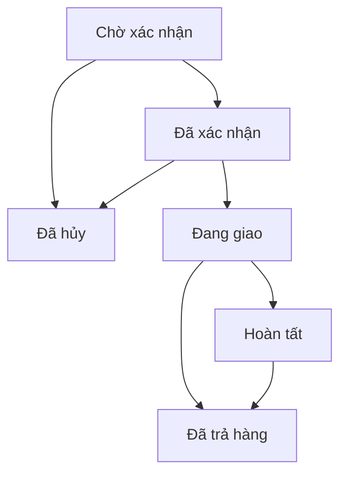

# AMORA Mini — Quản lý bán hàng & cộng tác viên

Bộ mã nguồn React + TypeScript + ASP.NET Core .NET 10 + PostgreSQL cho 2 quản lý và 5 CTV. Một backend, một database; không Redis, microservices hay AI.

## Bắt đầu nhanh

Yêu cầu Docker Desktop (Docker Engine + Compose v2).

```bash
python3 scripts/init-env.py
# Mở .env để lấy email/mật khẩu quản lý local.
docker compose up --build -d
```

Mở **http://localhost:3000**. Đăng nhập bằng thông tin trong `.env`, đổi mật khẩu khi được yêu cầu.

**Chưa có giá bán chính thức:** sau khi đăng nhập, vào **Bảng giá** nhập giá cho từng sản phẩm. Dữ liệu ban đầu chỉ gồm bốn mùi thật trong tài liệu AMORA; không tự đặt giá, dung tích hay thời gian cháy.

Quản lý đầu tiên được tạo từ biến Bootstrap khi database chưa có tài khoản. Vào **Cộng tác viên → Cấp tài khoản** để tạo thêm 1 quản lý và 5 CTV với email thật. Mỗi người nhận mật khẩu tạm riêng, bắt buộc đổi trước khi sử dụng. Không có mật khẩu dùng chung trong mã nguồn.

## Các chức năng đã triển khai

| Khu vực | Quản lý | CTV |
|---|---|---|
| Tổng quan | Số liệu toàn bộ | Số liệu cá nhân |
| Sản phẩm | Thêm, sửa, ẩn, tải và xóa ảnh | Xem sản phẩm đang hiện, mùi hương và giá lẻ |
| Bảng giá | Giá lẻ/sỉ/B2B, MOQ, % hoa hồng từng sản phẩm | Chỉ đọc giá lẻ, không sửa giá |
| Khách hàng | Xem và sửa toàn bộ, thêm khách | Thêm, xem và sửa khách của mình |
| Đơn hàng | Xem toàn bộ; tạo/giao phụ trách; xác nhận, giao, hoàn tất, thanh toán | Tạo, sửa khi chờ xác nhận chưa thu tiền; xem/hủy đơn chờ của mình |
| Báo giá | Tạo, sửa nháp, đổi trạng thái, tải PDF | Xem và xuất báo giá của mình; tạo/sửa theo thiết lập |
| Hoa hồng | Xem toàn bộ, duyệt và ghi nhận đã chi | Xem khoản cá nhân |
| Tài khoản | Cấp tối đa 2 quản lý + 5 CTV, sửa thông tin, khóa, đặt lại mật khẩu | Tự đổi mật khẩu |
| Thiết lập | Thông tin báo giá, chính sách CTV, sao lưu và nhật ký | Không truy cập |

Không thu thập giá vốn hoặc triển khai kế toán, kho tồn, nhà phân phối nhiều cấp, thanh toán trực tuyến. Thông tin thanh toán trong đơn là do quản lý xác nhận thủ công.

## Luồng sử dụng

1. Thiết lập thông tin doanh nghiệp trong **Thiết lập**: điện thoại, địa chỉ, email, ngân hàng, điều kiện báo giá.
2. Kiểm tra bốn sản phẩm, điền quy cách đã xác nhận và tải ảnh AMORA thật. Tài liệu hiện tại không có logo/ảnh sản phẩm dạng asset riêng nên giao diện dùng chữ thương hiệu, không vẽ logo hoặc ảnh nến giả.
3. Nhập bảng giá. Có thể đặt MOQ 20 lọ cho B2B, 40 mẫu cho sản phẩm sáp mini khi thêm vào. Mức tối thiểu tính **theo từng sản phẩm**, không cộng gộp cả danh mục.
4. Cấp sáu tài khoản còn lại, gửi thông tin đăng nhập riêng cho từng người.
5. CTV thêm khách → tạo đơn theo giá lẻ hoặc tạo báo giá nếu được phép.
6. Quản lý xác nhận đơn → giao hàng → hoàn tất; ghi nhận tổng tiền đã thu và mã giao dịch.
7. Khi đơn hoàn tất và thu đủ, hệ thống ghi hoa hồng chờ duyệt → quản lý duyệt → xác nhận đã chi kèm tham chiếu.
8. Sao lưu định kỳ. Khôi phục thử trên một database riêng trước khi cần dùng thật.

## Công thức và tính nhất quán

- Tiền dòng = số lượng × đơn giá, theo VND nguyên đồng.
- Tổng đơn = tổng tiền hàng + vận chuyển; chưa tự tính VAT, chiết khấu hay phụ phí.
- Hoa hồng dòng = làm tròn `tiền dòng × tỷ lệ / 100`, nửa đồng làm tròn lên.
- Hoa hồng đơn = tổng hoa hồng dòng; chỉ ghi nhận cho chủ đơn là CTV.
- Phí vận chuyển không tính hoa hồng.
- Tên, SKU, đơn vị, đơn giá, tỷ lệ hoa hồng và thông tin khách hàng được chốt tại chứng từ. Thay đổi bảng giá không tự sửa chứng từ đã lưu. Khi sửa đơn còn chờ hoặc báo giá nháp, chứng từ sẽ lấy tỷ lệ hiện tại; giá nhập bởi quản lý vẫn phải xác nhận khi lưu.
- CTV không sửa đơn giá, không dùng bảng giá sỉ/B2B. Quản lý có thể nhập giá riêng; tỷ lệ hoa hồng vẫn lấy từ chính sách từng sản phẩm/kênh.
- Sửa chứng từ, thanh toán và duyệt hoa hồng có kiểm tra `version`; yêu cầu cũ bị từ chối 409, yêu cầu tải lại.
- Hoa hồng có khóa duy nhất theo đơn; không tạo trùng khi ghi nhận tiền nhiều lần.

## Trạng thái

Đơn hàng:



CTV chỉ được hủy đơn của mình ở trạng thái chờ, có lý do. Đơn có tiền thu cần hoàn tiền ngoài hệ thống và cập nhật tiền thu về 0 trước khi hủy. Trả toàn bộ đơn trước khi chi hoa hồng sẽ vô hiệu hóa khoản hoa hồng. Trả một phần hoặc thu hồi hoa hồng **đã chi** chưa được hỗ trợ; hệ thống chặn trả hàng sau khi đã chi để quản lý đối soát trước, không tự xóa khoản chi lịch sử.

Báo giá: nháp → đã gửi → chấp nhận / từ chối; đã gửi có thể đưa về nháp để chỉnh. Chấp nhận báo giá không tự tạo đơn, tránh phát sinh đơn ngoài ý muốn. PDF có thông tin khách, dòng hàng, tổng tiền, vận chuyển, hiệu lực và điều kiện. Đây không phải hóa đơn điện tử.

## Cấu trúc

```text
backend/                 ASP.NET Core API; xác thực, phân quyền, nghiệp vụ
  Data/                  Migrations và dữ liệu ban đầu
  Endpoints/             Catalogue, Customers, Sales, Admin
  Services/              Xác thực và lưu ảnh R2/private local
frontend/                React + TypeScript + Vite
  src/                   Giao diện, API client, xuất PDF
  public/fonts/          Phông tiếng Việt và giấy phép
  nginx.conf             Reverse proxy cho Docker local
database/migrations/     SQL có phiên bản, chạy một lần có khóa
docs/                    Hướng dẫn triển khai, API, thiết kế và kiểm thử
scripts/                 Tạo cấu hình local, backup, khôi phục
tests/                   Kiểm thử API tích hợp
.github/workflows/       CI trên PostgreSQL 17
render.yaml              Blueprint backend Render Free
```

## Chạy không dùng Docker

Cài .NET 10 SDK, Node 24 LTS và PostgreSQL 17. Tạo database riêng, đặt biến môi trường cho backend:

```bash
export ASPNETCORE_ENVIRONMENT=Development
export ASPNETCORE_URLS=http://localhost:8080
export ConnectionStrings__Default='Host=localhost;Port=5432;Database=amora;Username=amora;Password=YOUR_PRIVATE_PASSWORD'
export Bootstrap__Email='YOUR_ADMIN_EMAIL'
export Bootstrap__Password='YOUR_PRIVATE_INITIAL_PASSWORD'
dotnet run --project backend
```

Trong terminal thứ hai:

```bash
cd frontend
npm ci
npm run dev
```

Mở http://localhost:5173. Vite proxy `/api` tới cổng 8080. Không đặt chuỗi kết nối database vào frontend.

## Triển khai miễn phí

Xem **[docs/DEPLOY.md](docs/DEPLOY.md)** cho từng bước Render + Neon + Cloudflare Pages + R2, biến môi trường, kiểm tra deploy, backup và khôi phục. Cần tài khoản của bạn tại các nhà cung cấp; mã nguồn không chứa khóa cloud.

Mục tiêu 0đ/tháng chỉ trong quota miễn phí. Không dùng Render PostgreSQL Free cho dữ liệu dài hạn. Backend Free có thể ngủ và cần thời gian khởi động. Bộ mã nguồn này chưa tự đăng ký hay xuất bản dịch vụ cloud.

## Kiểm tra

```bash
dotnet build backend -c Release
cd frontend
npm ci
npm run build
```

Luồng API được kiểm tra bằng `tests/integration.py`, dùng một database trống **chỉ dành cho test**. CI tạo PostgreSQL 17 riêng và chạy test tự động trên push/PR. Xem **[docs/TESTING.md](docs/TESTING.md)** để đọc bằng chứng kiểm tra và các phần cần nghiệm thu trên tài khoản cloud thật.

## Phân quyền và bảo mật

Backend kiểm tra quyền ở mọi thao tác có dữ liệu riêng. Session token ngẫu nhiên 256-bit; database chỉ giữ hash token. Phiên hết hạn sau 8 giờ, được thu hồi khi đăng xuất, đổi/đặt lại mật khẩu hoặc khóa tài khoản. Token chỉ lưu trong `sessionStorage` của tab, không có khóa cloud trong frontend.

Mật khẩu PBKDF2-SHA256 210.000 vòng, salt riêng. Sai 5 lần tạm khóa 15 phút; thêm giới hạn tần suất đăng nhập chung cho instance nhỏ. Không có chức năng tự đăng ký hoặc quên mật khẩu qua email. HTTPS bắt buộc khi đưa lên Internet. Các header CSP và chống nhúng trang được cấu hình cho Pages/nginx.

JSON backup chứa dữ liệu khách và mật khẩu đã băm, cần bảo vệ như bản backup database. Không gửi cho CTV, không commit lên GitHub. R2 bucket để private; ảnh được tải qua API có xác thực.

## Giới hạn có chủ đích

- Một cơ sở; không nhập/xuất kho, không công nợ sổ cái, không kế toán thuế.
- Không đồng bộ website, không cổng thanh toán, không email tự động, không AI.
- Danh sách đơn, báo giá và hoa hồng hiển thị 500 bản ghi gần nhất; nhật ký hiển thị 200. Backup giữ toàn bộ. Trước khi tăng dữ liệu, thêm phân trang phía server.
- Không đăng ký thêm tài khoản quá 7, không phân tầng CTV. Tài khoản khóa vẫn tính trong giới hạn; sửa thông tin để thay người và giữ trách nhiệm dữ liệu lịch sử theo quy định nội bộ.
- Tối đa 50 dòng/chứng từ, 8 ảnh/sản phẩm, 5 MB/ảnh. Không nén ảnh tự động; quản lý nên tải ảnh đã tối ưu.
- PDF chạy trên trình duyệt, có tiếng Việt và tự sang trang; không gửi chứng từ đến dịch vụ bên thứ ba. Font dùng DejaVu theo giấy phép kèm theo.
- Không khôi phục dữ liệu đè ngay trong UI; dùng script đích trống để tránh mất dữ liệu.
